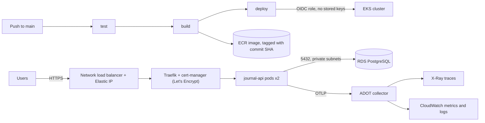

# Deployment guide

The Journal API runs on Amazon EKS: containerised, provisioned with Terraform,
deployed by GitHub Actions and observed with OpenTelemetry. The live environment
was torn down after verification, so this guide shows how to rebuild it.

## Architecture

## How a change reaches production

1. A push to `main` runs `.github/workflows/ci.yml`.
2. `test`: lint, type check and tests (with a Postgres service container).
3. `build`: builds the image, smoke-tests it (non-root user, `GIT_SHA` baked in,
   app imports), then pushes it to ECR tagged with the full commit SHA.
4. `deploy` (environment `production`): applies `k8s/` (namespace, service account, app, ingress), waits for the rollout, then checks that `/version` over HTTPS returns the commit that was just deployed. The pods read their secrets from Secrets Manager at startup and apply the database schema themselves.

AWS access from CI is keyless: GitHub's OIDC token is exchanged for a short-lived
session on the `github-actions-journal` role. No access keys are stored anywhere.

## Deploy from scratch

Prerequisites: AWS login (`aws login`), Terraform, kubectl, helm, jq.

1. Create the encrypted, versioned S3 bucket named in `infra/backend.tf`.
2. `cd infra && terraform apply` (cluster, database, network, secrets, observability).
3. Store the OpenAI settings: `aws secretsmanager put-secret-value --secret-id journal/openai ...`
   (JSON with `api_key`, `base_url`, `model`).
4. `./k8s/bootstrap.sh` installs cert-manager and Traefik, with the HTTP to HTTPS redirect.
5. Point the DuckDNS name at the load balancer IP (`terraform output ingress_public_ip`).
6. Merge to `main`: the pipeline deploys the app.

## Security controls

- **Identity:** the API runs as the `journal-api` service account. EKS Pod Identity gives it the `journal-api` IAM role, which can only read two secrets. No access keys exist anywhere.
- **Secrets:** `journal/database-url` and `journal/openai` live in Secrets Manager. The app reads them at startup (`SECRETS_SOURCE=aws`) and applies its own database schema. Nothing is stored in Kubernetes or on disk.
- **Network:** the database sits in private subnets and accepts port 5432 only from the cluster security group.
- **HTTPS:** Traefik redirects HTTP to HTTPS, cert-manager issues the certificate, and the API sends `Strict-Transport-Security`.
- **Audit and alerts:** a multi-region CloudTrail trail keeps logs for 100 days, and an EventBridge rule emails an alert when a security group changes. This lives in `infra-audit/` and is applied separately.
- **Scanning:** CodeQL runs on every push and pull request, and Dependabot checks weekly.
- **Incident response:** see `docs/runbooks/credential-leak.md`.

## Observe

- Dashboard `journal-api`, alarm `journal-api-errors` (three or more errors in 5 minutes).
- Traces in X-Ray, metrics in the `Journal` namespace, logs in `/journal/app`.
- Quick checks: `kubectl -n journal get pods`,
  `kubectl -n observability logs deploy/otel-collector`.

## Troubleshoot

| Symptom | Cause and fix |
|---|---|
| `Not authorized to perform sts:AssumeRoleWithWebIdentity` | GitHub's `sub` claim includes numeric IDs (`repo:OWNER@id/REPO@id:...`). Print the real claims and match the trust policy. |
| ECR push fails with `403 Forbidden` on a manifest request | The role also needs `ecr:BatchGetImage` and `ecr:GetDownloadUrlForLayer`. |
| Node group fails with `not eligible for Free Tier` | Free Plan accounts: choose a type from `aws ec2 describe-instance-types --filters Name=free-tier-eligible,Values=true`. |
| Helm: `values don't meet the specifications of the schema` | Validate with `helm template` before installing; chart keys change between versions. |
| `terraform destroy` stuck on subnets | Uninstall the Traefik release first so Kubernetes deletes the load balancer. |
| Pods not ready | Readiness probes `/entries`, which needs the database. Check the pod logs for a failed secret read (is the Pod Identity association in place?) or a database connection error. |
| No telemetry | Check the collector logs, then the Pod Identity association. |

## Known limitations

- The API has no authentication or per-user isolation (test data only).
- One NAT gateway and a single-AZ database; no high availability.
- The app copies its secrets into its process environment at startup and connects to the database as its master user; a least-privilege database user would be better. The collector image uses the latest tag.
- Probe traffic is included in request metrics; a dedicated health endpoint should skip tracing.
